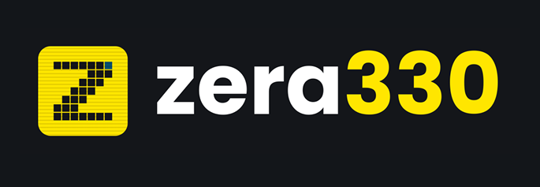

<p align="center"></p>

# zera330

Neo Geo MVS arcade emulation for Windows x64, with Linux ARM single-board computers as the next target. Part of the Zera family, alongside ZeraPS5. Maintained by **metallrockdev**.

## Development version: 0.1.0

The core is written in C11: 68000 and Z80 CPUs, the LSPC video chip, the YM2610 sound chip, the system I/O and the cartridge protection chips. MAME is used only as a measuring instrument: each behavior is compared against it by traces, memory dumps and frame captures, and the comparison method is recorded with each fix in [docs/ROADMAP.md](docs/ROADMAP.md).

## What to expect

- 168 of the 170 tested romsets boot and run their attract mode. The two that do not load (`powerins`, `sbp`) are not standard MVS cartridge sets. See the [compatibility list and last tested version](COMPATIBILITY.md).
- Video matches MAME pixel for pixel in 155 of 155 games compared at the same boot frame; sound matches the ymfm reference after the fixes in Achado #99.
- Protection chips emulated: CMC42, CMC50, SMA, PVC and NEO-PCM2 families.
- Battery-backed RAM is saved per game. Save states are available (F5 saves, F7 loads).

These results come from automated comparisons over the first minute of each game. They are not proof that every game plays correctly to the end.

## Downloads

This repository currently provides the source code. A packaged Windows release has not been published yet.

## Run

Build the project (see [CONTRIBUTING.md](CONTRIBUTING.md)), then:

```
build\bin\Zera330.exe
```

The launcher lists your games with title, year, maker and play time, and runs the emulator with the selected one (double click or **Jogar**). **Configurações** picks the games and BIOS folders; logs, battery saves and settings stay in `build\bin\user`. **Criar atalho** makes a desktop shortcut that opens a game directly (`Zera330.exe --jogar <set>`).

The emulator can also run on its own:

```
build\bin\zera330c.exe <game.zip> <bios_folder>
```

or through `jogar.bat`, which lists the games in `roms\zips` and opens the one you pick.

Every game starts with the 3-second zera330 opening. Any key, controller button or click skips it; Esc closes the emulator. Set `ZERA330_SEM_INTRO=1` to turn it off.

You need your own copies of the games and of the system BIOS, legally obtained from hardware you own. zera330 does not distribute games, BIOS or any other copyrighted ROM.

### Controls

| | Player 1 | Player 2 |
| --- | --- | --- |
| Directions | Arrows or WASD | IJKL |
| A B C D | Z X C V | B N M , |
| Start | 1 or Enter | 2 |
| Coin | 5 or Backspace | 6 |

Game controllers use the Xbox layout (A B X Y = Neo Geo A B C D, Back = coin); two are supported, with hotplug.

| Shortcut | Key |
| --- | --- |
| Service button | F1 |
| Pause / resume | P |
| Reset | F3 |
| Save / load state (`states/<game>.sta`) | F5 / F7 |
| Fullscreen | F11 or Alt+Enter |
| Screenshot (`capturas/`) | F12 |
| Quit | Esc |

All of these can be changed in the launcher, under **Configurações → Controles e teclado**: each input takes up to four keys and four controller buttons, each player can be tied to a specific controller, and the panel lights up as you press keys, so you can test the mapping there. **Configurações** also sets the window size, 4:3 or square pixels, smooth filter, scanlines, fullscreen and volume. Everything is stored in `user\config\zera330.ini`.

## Build and contribute

See [CONTRIBUTING.md](CONTRIBUTING.md). Brand rules are in [docs/IDENTIDADE.md](docs/IDENTIDADE.md).

Recorded checks and their limits are described in [VALIDATION.md](VALIDATION.md). See [CHANGELOG.md](CHANGELOG.md) for technical changes.

## Credits and licenses

zera330 is distributed under the GNU General Public License version 2 ([LICENSE](LICENSE)). Third-party components and references keep their own licenses; see [CREDITS.md](CREDITS.md) and [licenses/](licenses/).

zera330 is not affiliated with SNK. Neo Geo is a trademark of SNK Corporation and is mentioned only to name the compatible hardware.
